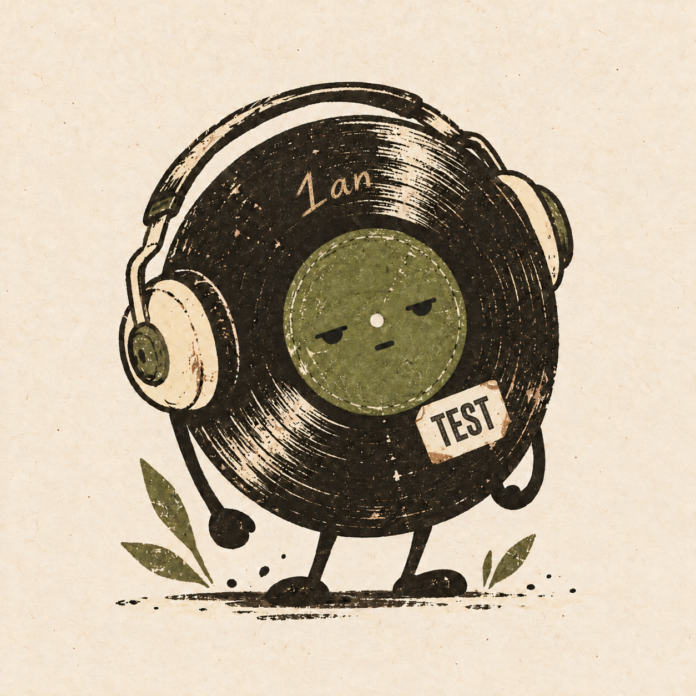

# 1an's Discord Music Bot

A YouTube music bot that only requires a Discord bot token. Join a voice channel and run `/play link:<YouTube URL>` in a text channel. The bot joins your voice channel and starts playback.

<p>
  
  
</p>

## Features

- Play individual YouTube URLs, import YouTube playlists and Mix snapshots, or search by song name. Search selects the first result and does not guarantee an official recording.
- Spotify links (including `spotify.link` shares) work with `/play` and `/playnext`. Public track, playlist, and album metadata is matched to YouTube audio without Spotify login, client credentials, or account binding. The first readable entry can start playback while the rest join the queue in their original order. Repeated songs are retained, and `/playnext` can insert a Spotify collection ahead of the waiting queue without interrupting playback.
- Spotify requests search YouTube using the artist and title plus `official audio`, then play the first result. There is no separate candidate ranking, artist-name filter, or duration filter; the first result may be a different version. Audio comes from YouTube, not Spotify; the panel links back to the original Spotify track. Public-page metadata can change or be unavailable by region; use a YouTube URL if single-track lookup fails. Podcasts and direct Spotify audio are not supported.
- Once playback starts, the bot prepares the next five waiting tracks' source URLs in the background, resolving them serially with one worker per server. Each track transition retains ready entries and fills the next available slot. Skip and normal track transitions reuse a ready or in-flight lookup instead of starting the same search again. Priority insertions cancel obsolete preparation, and leaving or stream recovery cancels background preparation. No next-track audio is buffered. Expired or failed prepared sources use a fresh lookup; an HTTP failure on a prepared URL gets one fresh-source retry. Skipping before preparation finishes can still require waiting.
- Playlist and Mix entries load progressively: playback can start as soon as the first playable entry arrives, while the remaining entries join the queue in their original order. Later `/play` requests stay behind that import; `/playnext` retains priority. Leaving cancels background imports. Mixes remain limited to 20 entries and the waiting queue to 300 tracks. If a background import fails, already loaded tracks remain available; diagnostics stay in service logs.
- When starting playback, the command's private thinking indicator remains until audio actually starts. Adding tracks to an existing session completes immediately after enqueueing. Failures, cancellation, and a two-minute startup timeout settle the private response instead of leaving it pending.
- A compact public Now Playing card with artwork, track link, artist or uploader, elapsed time, duration, and playback controls. Upcoming tracks are shown only on demand through `/queue` or the queue button, in a shared public paginated view with eight tracks per page. The queue stays hidden until requested and replaces the current-track view in the same shared message. A new track automatically restores Now Playing; `/now-playing` and the return button also restore it.
- Pause/resume, skip, and stop buttons, plus previous/next queue pages with page numbers. Progress refreshes every second during playback and stops refreshing while paused. Pending edits are coalesced when Discord throttles updates.
- Separate queues and voice connections for each Discord server; one active voice channel per server.
- Up to 300 queued tracks and automatic disconnect after three idle minutes once the current track and waiting queue have finished. Commands from the same voice channel reset this idle countdown; new playback cancels it. Controls require membership in the bot's voice channel.
- Supports live volume adjustment (0–100%), with new sessions starting at 50%. The test branch decodes and re-encodes Opus to apply volume, adding CPU work compared with the production passthrough path.

## Development and environments

`main` is the only persistent branch. Production and test deployments use the same source revision from `main`, with separate local tokens, directories, and services. Create your own feature branch when developing, validate it in the test environment, and merge it into `main` when ready. There is no permanent `test` branch.

The current `main` enables self-deafening when joining voice. This development branch disables self-deafening in the test deployment, imports YouTube playlists and Mix snapshots (including video URLs with a `list` parameter), and publishes the player panel only after audio playback begins. Loading messages, queue-import notices, and technical diagnostics are not posted publicly. Successful command acknowledgements are dismissed; command errors are private to the requester. No real tokens or `.env` files are included in this repository.

## Create and invite your bot

1. Create an application in the [Discord Developer Portal](https://discord.com/developers/applications) and obtain its bot token from the Bot page.
2. In the OAuth2 URL Generator, select `bot` and `applications.commands`, using Guild Install.
3. Grant View Channels, Send Messages, Embed Links, Connect, and Speak. Open the generated invite URL and choose your server.
4. Privileged intents such as Message Content are not required.

The bot obtains its application ID after login and registers global commands automatically. No Client ID or Guild ID configuration is required. Registration replaces the application's global commands, so use a dedicated application. Command updates may take time to appear.

## Local installation

Requirements: Node.js 22.12 or newer (Node 24 LTS recommended), Python 3, and Python venv support. Direct installation has been verified on a Raspberry Pi 3 Model B running ARM64 Debian 12.

```sh
git clone https://github.com/Ian-I-Chien/Discord-Music-Bot.git
cd Discord-Music-Bot
python3 -m venv .venv
.venv/bin/pip install -U 'yt-dlp[default]'
npm ci
cp .env.example .env
```

Edit `.env`:

```env
DISCORD_TOKEN=your_bot_token
```

Start the bot:

```sh
PATH="$PWD/.venv/bin:$PATH" npm start
```

Only `DISCORD_TOKEN` is required. Optionally set `YTDLP_PATH` to an explicit yt-dlp executable path; otherwise it is resolved from PATH. The bot enables Node as the YouTube JavaScript challenge runtime. `yt-dlp[default]` includes the challenge solver.

`npm run register` can update global commands separately, but normal startup already registers them.

The bot updates its voice channel status with only the current song title, without playing or paused labels. It clears its status when playback ends or it leaves. Grant **Set Voice Channel Status** in the server/channel permissions; missing permissions do not interrupt playback.

## Commands

| Command | Action |
| --- | --- |
| `/play link:<URL or song name>` | Join your voice channel and play, or add to the queue |
| `/playnext link:<URL or song name>` | Insert a YouTube track or Spotify track/collection ahead of the waiting queue without interrupting the current song |
| `/random-play link:<playlist URL>` | Shuffle a YouTube playlist/Mix or public Spotify playlist/album before choosing the first song |
| `/volume percent:<0–100>` | Join your voice channel if needed and set volume immediately; 0 mutes, 100 is original level. The idle player and queue also show current volume. |
| `/repeat mode:<off|track|queue>` | Turn repeat off, repeat the current track, or loop the active queue |
| `/pause` | Pause playback |
| `/resume` | Resume playback |
| `/previous` | Replay the previous track from the beginning; return the interrupted track to the front of the queue |
| `/skip` | Skip the current track |
| `/now-playing` | Switch the shared message back to the current track |
| `/queue` | Open the shared, paginated view of upcoming tracks |
| `/leave` | Clear the queue and disconnect |

Join a regular voice channel first. Stage channels, live streams, and restoring queues after a restart are not currently supported. Startup clears leftover voice membership; `/leave` can also disconnect a stale connection without an in-memory playback session. Mix links import at most 20 tracks per request to reduce startup time; they do not enable endless radio playback. Playlist imports use the available queue capacity (up to 300 waiting tracks); unavailable tracks may be skipped. A video URL containing a `list` parameter imports that playlist. Remove the `list` parameter to play only the video. Bot responses and command descriptions are currently in Traditional Chinese.

## Docker Compose

With Docker Engine and the Compose plugin installed, configure `.env` and run:

```sh
docker compose up -d --build
docker compose logs -f --tail=50
```

To rebuild with updated images and yt-dlp:

```sh
docker compose build --pull --no-cache
docker compose up -d
```

The image includes Node 24, a Python venv, yt-dlp, FFmpeg, and the native Opus build toolchain. The current Opus playback path does not use FFmpeg. Volume processing uses native @discordjs/opus at 192 kbps. Native compilation requires a C/C++ toolchain, make, Python, and Node headers when a matching prebuilt binary is unavailable. The ARM64 Docker build has not been verified; the existing Pi uses direct installation.

## Existing Raspberry Pi deployment

Production and testing run as separate systemd user services:

| Environment | Directory | Service |
| --- | --- | --- |
| Production | `~/youtube-discord-bot` | `youtube-discord-bot` |
| Test | `~/youtube-discord-bot-test` | `youtube-discord-bot-test` |

`activate-pi.sh` is specific to the existing production deployment. It assumes Node is installed at `~/.local/lib/music-node/bin` and the systemd unit already exists. On a new machine, install and configure your own service or use Docker.

```sh
systemctl --user restart youtube-discord-bot
journalctl --user -u youtube-discord-bot -n 50 --no-pager
# Use youtube-discord-bot-test for the test service.
```

Keep each environment's `.env`, venv, and service configuration local when updating source code. Never deploy the test token to production.

## Validation and troubleshooting

```sh
npm test
node --check src/bot.js
```

Tests cover input validation, global command registration, embed payloads, time formatting, and paused/ended control states. Dependency loading, public YouTube source resolution and audio fetching, bot login, and command registration have been verified on the Pi. Audible Discord playback, visual appearance, and the deafen indicator require manual acceptance testing.

- Embeds require Embed Links permission. For missing audio, check Connect, Speak, server mute settings, and outbound UDP connectivity.
- Outbound HTTPS, WebSocket, and UDP access is required. Typical home NAT setups do not need inbound port forwarding.
- YouTube may restrict content by region, account, or source IP. Updating yt-dlp does not resolve every restriction. Cookies are not loaded automatically.
- Unsupported live streams or videos without WebM Opus audio produce an error before the bot attempts the next queued track.
- Raspberry Pi 3 has limited memory; start by testing one voice channel. Audio quality depends on the YouTube source and Discord and is not lossless.

## Secrets and version control

`.gitignore` excludes `.env`, `.env.*`, dependencies, Python environments, logs, and backups. Only the empty `.env.example` template is tracked. Never put tokens in source code, screenshots, commits, or this README. Reset an exposed token immediately in the Developer Portal.

Invoking `/now-playing` posts a new active playback panel at the latest position in chat, preserving the track, elapsed time, volume and queue. Controls on the previous panel are removed.

### Stream recovery

Premature endings and player errors retain the current track and queue while the bot reconnects. Recovery makes at most three attempts within a shared ten-second budget; it seeks to the saved playback position and preserves volume. Failed recovery advances once to the next track. Skip and leave cancel pending recovery. Playback progress includes the resumed offset. Recovery diagnostics stay in service logs. Reconnection can repeat or skip a small amount of audio and is not guaranteed to be seamless.

The queue panel return button switches back to the player on the same message. Only an explicit `/now-playing` command posts a replacement panel at the latest chat position.

### Empty voice channels

When no human listeners remain in the bot voice channel, a separate three-minute countdown starts even while music is playing or queued. A human returning cancels the countdown; another departure starts a new countdown. Other bots and mute/deafen changes do not reset it. On timeout the bot stops playback, clears the queue and leaves. The existing three-minute idle timeout after playback ends also remains active.

When a new track starts, the bot posts a new active playback panel and then deletes the previous active panel. Pause/resume and reconnecting the same track keep the existing message. If sending fails the original remains; if deletion fails its controls are removed.

Automatic progress refreshes skip ticks while a panel request is pending. This lets the request finish under Discord rate limits so queue, pause/resume and other user controls can proceed.

## Spotify public collections

### Random playlist playback

Use `/random-play link:<playlist URL>` to start with a random song and play the imported entries in shuffled order, without replacement. `/play` keeps the original order. An existing song keeps playing, and the shuffled block is appended without rearranging unrelated queued songs. Intentional duplicate entries are preserved.

Random playback first collects a bounded metadata snapshot, so startup can take longer than sequential first-track playback. It does not resolve all audio sources first: after playback starts, the next five sources prepare in the shuffled order. Mixes still import at most 20 entries, other imports use the available queue capacity (up to 300), and Spotify still uses only publicly readable entries. It does not sample hidden Spotify entries or enable repeat. Stop cancels collection and prevents late songs from appearing. If a metadata source fails partway through, the readable subset is shuffled and service logs retain the diagnostic.

Only `DISCORD_TOKEN` is required. Spotify links supply public song metadata; all audio is resolved and played from YouTube. There is no Spotify account authorization, OAuth callback, token storage, or owner-specific API access.

Public Spotify embeds may expose only part of a collection, commonly the first 100 playlist entries. A 580-track playlist can therefore yield only 100 tracks. The bot does not invent missing songs, replace the list with a YouTube Mix, or claim the visible subset is the complete playlist. When the original total is available, the queue footer shows the public visible count and original total. Use a YouTube playlist link to import a larger ordered list, subject to the existing 300-track queue capacity.

Shorter public playlists and albums import the readable songs in order, preserving duplicates. Metadata limits, regional availability, and changes to Spotify's public pages may affect imports. First-track playback does not wait for the optional source-size lookup. Stopping the session cancels background work; loading notices and technical diagnostics stay out of public chat.

## Repeat modes

Use `/repeat mode:off|track|queue` or the repeat button on either panel. Off is the default. Track replays the current song after a normal ending; Queue returns completed songs to the tail of the active queue, including later additions and intentional duplicates. Changing modes does not interrupt playback or change volume.

Skip always advances; Queue mode returns the skipped song to the tail. Previous preserves the interrupted song once. Failed playback is not repeated after recovery is exhausted. The prepared-source window stays bounded to five and follows repeat order; expired sources are resolved again. Stop clears the mode and queue, and the three-minute empty-voice disconnect applies in every mode.
